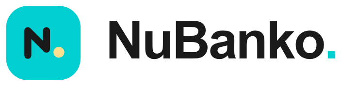
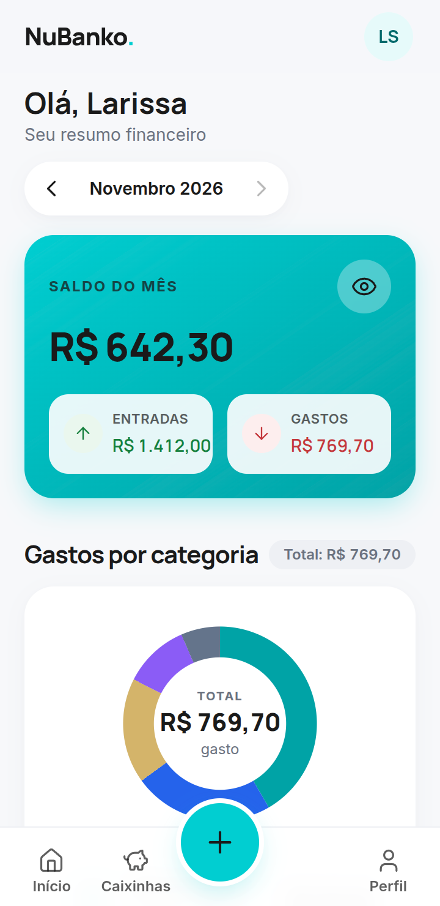
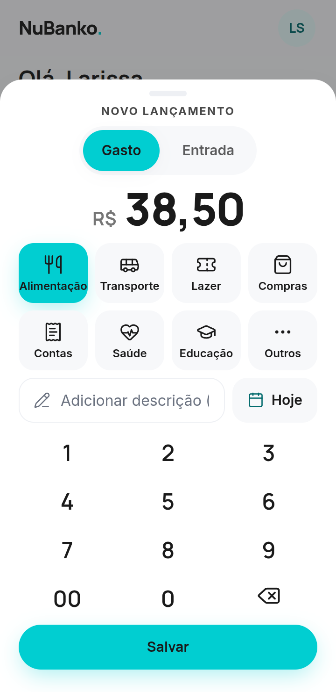

<div align="center">

<picture>
  <source media="(prefers-color-scheme: dark)" srcset="docs/assets/logo-escuro.png">
  
</picture>

### Seu primeiro salário, sob controle.

Um app de controle financeiro para quem está começando a ganhar o próprio dinheiro:<br>
registre um gasto em segundos, veja o mês de relance e junte para o que importa.

<br>


[Sobre](#-sobre) · [Objetivos](#-objetivos) · [Funcionalidades](#-funcionalidades) · [Telas](#-telas) · [Começando](#-começando) · [Documentação](#-documentação) · [Contribuindo](#-contribuindo)

</div>

---

## 💡 Sobre

Quem tem entre 18 e 24 anos e acabou de receber o primeiro salário ou a bolsa de estágio geralmente **não sabe para onde o dinheiro vai**. Planilhas dão trabalho demais e são abandonadas em poucos dias.

O **NuBanko** resolve isso com três coisas, e só três:

| | |
|---|---|
| ⚡ **Registro rápido** | Um gasto ou uma entrada em **3 toques** além do valor: "+", categoria, "Salvar". |
| 🎯 **Caixinhas** | Metas com nome, valor e prazo. O app mostra o progresso e **quanto guardar por mês**. |
| 📊 **Painel do mês** | Saldo, entradas, gastos e para onde foi o dinheiro, numa visão que **se entende em segundos**. |

> O NuBanko **não é um banco** e não movimenta dinheiro. Ele ajuda você a enxergar e organizar o seu.

### Para quem é

<table>
<tr>
<td width="90" align="center">👩🏽‍🎓</td>
<td>

**Lari, 19 anos, jovem aprendiz.** Recebeu o primeiro dinheiro próprio e quer juntar para um celular novo. Já tentou planilha e desistiu na segunda semana. Usa o celular para tudo, quer registrar um gasto em poucos segundos e precisa confiar que **só ela** vê os próprios dados.

</td>
</tr>
</table>

## 🧭 Objetivos

**O que buscamos**
- **Simplicidade acima de tudo:** se for mais trabalhoso que uma planilha, falhamos.
- **Privacidade de verdade:** cada pessoa vê só os próprios dados, a senha é guardada com hash, o tráfego é só por HTTPS e coletamos o mínimo (nome, e-mail e o que você registra).
- **Acessível e feito para o polegar:** alvos de toque de 44 px, ação principal na parte de baixo da tela, contraste AA e navegação por teclado.
- **Qualidade rastreável:** todo requisito tem um ID (`R-02.3`) e um teste que o cobre.

**O que não faremos na v1**
- Inteligência artificial, conexão com bancos, Pix, investimentos ou rendimento.
- Gamificação (níveis, conquistas) e notificações.
- App nativo nas lojas: começamos como **PWA**, instalável pelo navegador.

**O que nunca queremos ser**
- Um app que "funciona", mas pede mais toques que uma planilha.
- Um app em que alguém consiga ver dados de outra pessoa.
- Um app que promete segurança que não tem.

## ✨ Funcionalidades

| Funcionalidade | Status |
|----------------|:------:|
| Painel do mês: saldo, entradas, gastos, rosca por categoria e troca de mês | ✅ |
| Esconder valores com o "olho" (para usar em lugar público) | ✅ |
| Novo lançamento em bottom sheet com teclado numérico próprio | ✅ |
| Lista de lançamentos por dia, com editar e excluir | ✅ |
| Caixinhas: criar, editar, guardar, retirar, sugestão mensal e metas atingidas | ✅ |
| Perfil, edição do nome e página de privacidade em linguagem simples | ✅ |
| Login e cadastro (telas prontas, com sessão de demonstração) | 🟡 |
| Backend Supabase com regras de acesso por dono (RLS) | 🔜 |
| Ambiente local com Docker Compose | 🔜 |
| Testes E2E e de usabilidade com Playwright e axe | 🔜 |

✅ pronto · 🟡 pronto no front, aguardando backend · 🔜 planejado

## 📱 Telas

<div align="center">
<table>
<tr>
<td align="center"><br><sub><b>Painel do mês</b></sub></td>
<td align="center"><br><sub><b>Novo lançamento</b></sub></td>
<td align="center"><br><sub><b>Caixinhas</b></sub></td>
<td align="center"><br><sub><b>Detalhe da caixinha</b></sub></td>
</tr>
</table>
<sub>Capturas reais do app em 360×740, com os dados de demonstração.</sub>
</div>

## 🚀 Começando

**Você precisa de:** [Node.js](https://nodejs.org) 26 e npm 11.

```bash
git clone git@github.com:hullick/Desafio-Kodie-Final.git
cd Desafio-Kodie-Final/web
npm install
npm start
```

Abra **http://localhost:4200**. O app já entra logado com os dados de demonstração. Se sair, use `lari@exemplo.com` e qualquer senha.

<details>
<summary><b>📲 Ver no celular</b></summary>

<br>

```bash
npx ng serve --host 0.0.0.0
```

No celular, conectado à mesma rede Wi-Fi, abra `http://<ip-do-seu-computador>:4200`.

</details>

<details>
<summary><b>🧪 Testes e build</b></summary>

<br>

```bash
npx ng test --watch=false            # testes unitários e de componente
npx ng test --watch=false --coverage # com cobertura (mínimo de 80%)
npm run build                        # build de produção (PWA)
```

</details>

> **Atenção:** por enquanto os dados ficam **em memória**. Recarregar a página volta tudo ao início. O Supabase entra nas próximas etapas.

## 🏗️ Como é feito

| | |
|---|---|
| **Front** | Angular 22 (standalone, signals, zoneless), Tailwind CSS 4, ícones Lucide, PWA |
| **Arquitetura** | Atomic Design (átomos → moléculas → organismos → templates → páginas) com um **facade** por página |
| **Dados** | Repositórios abstratos: em memória hoje, Supabase (Postgres, Auth e RLS) em seguida, sem mexer nas telas |
| **Testes** | Vitest e TestBed hoje; Playwright, axe e pgTAP no plano |
| **Método** | Desenvolvimento orientado a specs: spec → plan → testes → código |

```
web/src/app/
├── core/    regras puras, tipos, datas, dinheiro e contratos de dados
├── ui/      design system: atoms · molecules · organisms · templates
└── pages/   uma pasta por tela: <nome>.page.ts + <nome>.facade.ts
```

## 📚 Documentação

| Documento | Para quê |
|-----------|----------|
| [**Guia de desenvolvimento**](DESENVOLVIMENTO.md) | **Comece aqui se você vai programar.** Como rodar, arquitetura, receitas, testes e convenções. |
| [Specs](docs/specs/README.md) | O **quê** e o **porquê** de cada funcionalidade, com os requisitos e critérios de usabilidade. |
| [Plans](docs/plans/) | O **como**: as tarefas de implementação de cada spec. |
| [Design system](design/nubanko_neo_fintech/DESIGN.md) | Cores, tipografia e componentes. Os mockups estão em `design/`. |
| [Registro de IA](docs/ai/registro-ia.md) | O que foi pedido a ferramentas de IA e o que elas geraram. |

## 🤝 Contribuindo

1. Leia o [guia de desenvolvimento](DESENVOLVIMENTO.md) e a spec da funcionalidade.
2. Crie **uma branch por feature**, a partir de `develop`: `feature/<spec>-<assunto>` ou `fix/<spec>-<assunto>`.
3. Escreva os testes junto com o código e cite o ID do requisito (`R-04.3`).
4. Commits em português e no imperativo: `feat(R-02.3): adiciona teclado numérico`.
5. Abra o PR para `develop`. O fluxo é `develop` → `test` → `master`; **nunca commite direto em `master`**.

## 📄 Licença

Distribuído sob a licença **MIT**. Veja [LICENSE](LICENSE).

<div align="center">
<br>
<sub>Feito com 💙 para quem está começando.</sub>
</div>
