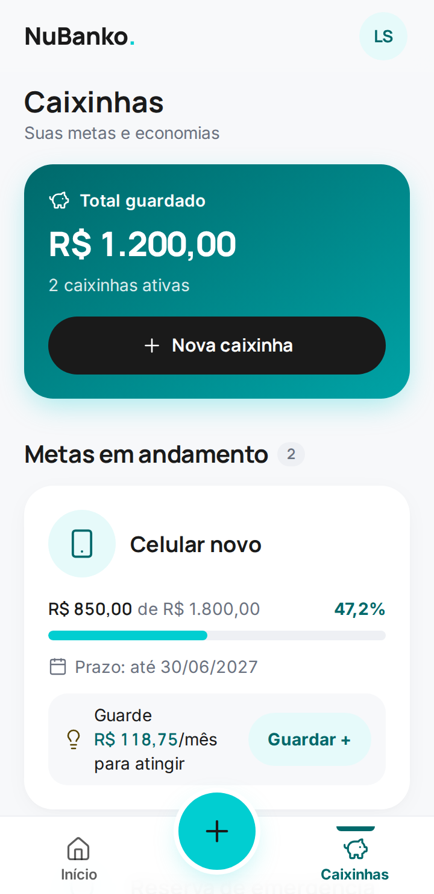
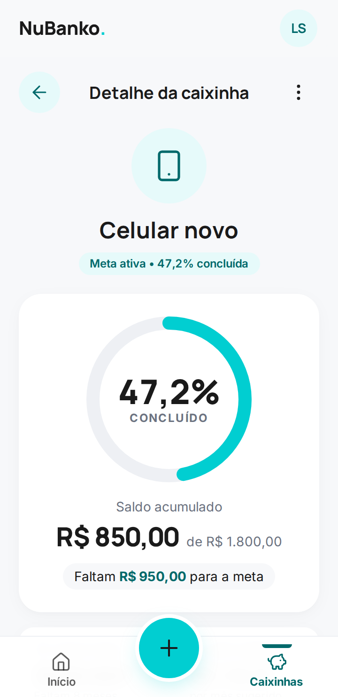

<div align="center">

<picture>
  <source media="(prefers-color-scheme: dark)" srcset="docs/assets/logo-escuro.png">
  
</picture>

### Seu primeiro salário, sob controle.

Um app de controle financeiro para quem está começando a ganhar o próprio dinheiro:<br>
registre um gasto em segundos, veja o mês de relance e junte para o que importa.

<br>

### [🌐 Abrir o NuBanko](https://nubanko-kodie.netlify.app)

<br>

[](https://app.netlify.com/projects/nubanko-kodie/deploys)


[Sobre](#-sobre) · [Equipe](#-equipe) · [Acesse](#-acesse) · [Apresentação](#-apresentação) · [Funcionalidades](#-funcionalidades) · [Prompt Log](#-prompt-log) · [Qualidade e LGPD](#-qualidade-segurança-e-lgpd) · [Avaliação crítica](#-avaliação-crítica) · [Registros individuais](#-registros-individuais) · [Documentação](#-documentação)

</div>

---

## 💡 Sobre

Quem tem entre 18 e 24 anos e acabou de receber o primeiro salário ou a bolsa de estágio geralmente **não sabe para onde o dinheiro vai**. Planilhas dão trabalho demais e são abandonadas em poucos dias.

O **NuBanko** resolve isso com três coisas, e só três:

| | |
|---|---|
| ⚡ **Registro rápido** | Um gasto ou uma entrada em **3 toques** além do valor: "+", categoria, "Salvar". |
| 🎯 **Caixinhas** | Metas com nome, valor e prazo. O app mostra o progresso e **quanto guardar por mês**. |
| 📊 **Painel do mês** | Saldo, entradas, gastos e para onde foi o dinheiro, numa visão que **se entende em segundos**. |

> O NuBanko **não é um banco** e não movimenta dinheiro. Ele ajuda você a enxergar e organizar o seu.

### Para quem é

<table>
<tr>
<td width="90" align="center">👩🏽‍🎓</td>
<td>

**Lari, 19 anos, jovem aprendiz.** Recebeu o primeiro dinheiro próprio e quer juntar para um celular novo. Já tentou planilha e desistiu na segunda semana. Usa o celular para tudo, quer registrar um gasto em poucos segundos e precisa confiar que **só ela** vê os próprios dados.

</td>
</tr>
</table>

## 👥 Equipe

| Integrante | Papel | Entregável do papel |
|------------|-------|---------------------|
| Luís | Product Owner | Problema, persona e funcionalidades priorizadas: [Sobre](#-sobre) e [specs](docs/specs/README.md) |
| Pedro Henrique Amaral | UX/UI Designer | Protótipo das telas, fluxo e identidade visual: [`design/`](design/) e [design system](design/nubanko_neo_fintech/DESIGN.md) |
| Vinícius Noronha | AI Builder | Prompt mestre e [Prompt Log](#-prompt-log) |
| Claudio | Tech Lead | Estrutura técnica e decisões: [guia de desenvolvimento](DESENVOLVIMENTO.md), [ADR do backend](docs/adr/0001-backend-netlify.md) e [API](docs/api/openapi.yaml) |
| Hullick Bartholo Gomes | QA e Privacidade | Plano de testes, registro de bugs e checklist de segurança e LGPD: [Qualidade, segurança e LGPD](#-qualidade-segurança-e-lgpd) |

## 🧭 Objetivos

**O que buscamos**
- **Simplicidade acima de tudo:** se for mais trabalhoso que uma planilha, falhamos.
- **Privacidade de verdade:** cada pessoa vê só os próprios dados, a senha é guardada com hash, o tráfego é só por HTTPS e coletamos o mínimo (nome, e-mail e o que você registra).
- **Acessível e feito para o polegar:** alvos de toque de 44 px, ação principal na parte de baixo da tela, contraste AA e navegação por teclado.
- **Qualidade rastreável:** todo requisito tem um ID (`R-02.3`) e um teste que o cobre.

**O que não faremos na v1**
- Inteligência artificial, conexão com bancos, Pix, investimentos ou rendimento.
- Gamificação (níveis, conquistas) e notificações.
- App nativo nas lojas: começamos como **PWA**, instalável pelo navegador.

**O que nunca queremos ser**
- Um app que "funciona", mas pede mais toques que uma planilha.
- Um app em que alguém consiga ver dados de outra pessoa.
- Um app que promete segurança que não tem.

## ✨ Funcionalidades

| Funcionalidade | Status |
|----------------|:------:|
| Cadastro e login com e-mail e senha, sessão em cookie seguro | ✅ |
| Painel do mês: saldo, entradas, gastos, rosca por categoria e troca de mês | ✅ |
| Esconder valores com o "olho" (para usar em lugar público) | ✅ |
| Novo lançamento em bottom sheet com teclado numérico próprio | ✅ |
| Lista de lançamentos por dia, com editar e excluir | ✅ |
| Caixinhas: criar, editar, guardar, retirar, sugestão mensal e metas atingidas | ✅ |
| Perfil (pelo avatar no topo): editar nome, trocar senha e excluir a conta com todos os dados | ✅ |
| Página de privacidade em linguagem simples | ✅ |
| Dados no Netlify DB, com cada pessoa vendo só os próprios dados (RLS) e textos cifrados | ✅ |
| PWA instalável pelo navegador | ✅ |
| **Automações:** perfil criado no banco a cada cadastro (trigger), sugestão automática de quanto guardar por mês em cada caixinha e deploy automático com testes a cada versão (GitHub Actions → Netlify) | ✅ |
| Recuperação de senha por e-mail | 🟡 |

✅ no ar · 🟡 pronto, desligado até configurarmos o envio de e-mail

## 🚀 Acesse

| | |
|---|---|
| 🌐 **App** | **[nubanko-kodie.netlify.app](https://nubanko-kodie.netlify.app)** (funciona no navegador do celular e pode ser instalado na tela inicial) |
| ⚙️ **Projeto na Netlify** | [app.netlify.com/projects/nubanko-kodie](https://app.netlify.com/projects/nubanko-kodie) · [deploys](https://app.netlify.com/projects/nubanko-kodie/deploys) |
| 🏷️ **Versão atual** | **1.0.4** · o que mudou em cada versão está no [CHANGELOG](CHANGELOG.md) |

### Contas de demonstração

Entre com uma delas para ver o app já com três meses de uso (setembro a novembro de 2026), ou crie a sua conta em **Criar conta**.

| Pessoa | E-mail | Senha | O que tem |
|--------|--------|-------|-----------|
| 👩🏽‍🎓 Lari, jovem aprendiz | `lari.demo@example.com` | `Nubanko@2026` | Salário de R$ 1.412, gastos do dia a dia e as caixinhas "Celular novo" e "Reserva de emergência" |
| 👨🏻‍💻 Pedro, estagiário | `pedro.demo@example.com` | `Nubanko@2026` | Bolsa de R$ 1.800 e um freela, curso, e as caixinhas "Viagem de fim de ano" (quase lá) e "Notebook" |
| 👩🏾‍💼 Ana, primeiro emprego | `ana.demo@example.com` | `Nubanko@2026` | Salário de R$ 2.600, aluguel e mercado, "Presente da mãe" (meta atingida) e "Primeiro carro", com uma retirada |

> As contas são **públicas**: qualquer pessoa pode entrar nelas e mudar os dados. Para guardar coisas suas, crie a sua própria conta.

## 🎤 Apresentação

| | |
|---|---|
| 📊 **Slides do pitch** | [NuBanko — Pitch de Produto (.pptx)](docs/slides/nubanko-pitch.pptx) |
| 🎬 **Vídeo de demonstração (1 min)** | *em produção: o link entra aqui* |

## 📱 Telas

<div align="center">
<table>
<tr>
<td align="center"><br><sub><b>Painel do mês</b></sub></td>
<td align="center"><br><sub><b>Novo lançamento</b></sub></td>
<td align="center"><br><sub><b>Caixinhas</b></sub></td>
<td align="center"><br><sub><b>Detalhe da caixinha</b></sub></td>
</tr>
</table>
<sub>Capturas do app publicado, em 360×740, com a conta de demonstração da Lari.</sub>
</div>

## 🤖 Prompt Log

Ferramentas de IA usadas: ferramenta de design para os mockups e o design system (`design/`) e **Claude Code** para specs, código, testes, deploy e documentação. O histórico técnico completo de pedidos está em [`docs/ai/registro-ia.md`](docs/ai/registro-ia.md).

**Prompt mestre** (AI Builder): *Vinícius Noronha, a incluir.*

| # | Integrante | Prompt | Objetivo | Resultado da IA | Correções feitas |
|---|------------|--------|----------|-----------------|------------------|
| 1 | Hullick (QA e Privacidade) | "Aja como um especialista em UX e testes web para verificar se o nível está excelente de testes; verifique também com Playwright, não só testes unitários." | Avaliar a qualidade da suíte e testar a navegação como a pessoa usuária faria, no navegador | Criou o E2E da navegação inferior (ordem do menu, "+" na zona do polegar, alvos de 44 px, troca de aba, teclado) e conferiu as telas com o Playwright | O teste revelou que a **aba atual nunca ficava destacada** (mesma cor das outras). Corrigimos o estilo (cor, negrito e barra, sem depender só de cor) e o teste passou a checar isso. Também apontou lacunas: smoke em produção, regressão visual, falhas de rede e WebKit |
| 2 | Hullick (QA e Privacidade) | "Request URL …/api/auth/sign-up/email · Status code 502 Bad Gateway" (log do navegador colado para a IA investigar) | Descobrir por que o cadastro falhava no site publicado | Identificou que o pooler do Netlify DB recusava o `search_path` enviado na conexão | A configuração passou para o papel do banco, a versão 1.0.2 foi publicada e o cadastro voltou (ver bug B-01) |
| 3 | Luís (PO) | *a incluir* | | | |
| 4 | Pedro Henrique Amaral (UX/UI) | *a incluir* | | | |
| 5 | Vinícius Noronha (AI Builder) | *a incluir* | | | |
| 6 | Claudio (Tech Lead) | *a incluir* | | | |

## 🛡️ Qualidade, segurança e LGPD

*Responsável: Hullick Bartholo Gomes (QA e Privacidade).*

### Plano de testes

| Camada | Ferramenta | O que cobre | Quantidade |
|--------|------------|-------------|-----------:|
| Unidade e componente | Vitest + TestBed | Regras de dinheiro, datas e senha; cada componente do design system; cada facade de página | 226 (98% de cobertura) |
| API | Vitest contra Postgres real | Cadastro, login, sessão, lançamentos, caixinhas, resumo, perfil, contrato OpenAPI, isolamento entre contas | 93 |
| Banco | pgTAP | RLS obrigatória em toda tabela, uma pessoa nunca lê dados de outra, exclusão em cascata | 64 |
| Ponta a ponta | Playwright, em 360×740 e 390×844 | Caminho feliz da persona (cadastro → lançamento → painel → caixinha), validações, perfil, troca de senha, exclusão de conta, navegação | 64 |
| Acessibilidade | axe (WCAG 2.1 A/AA) dentro do Playwright | Todas as telas públicas e logadas, sem violações graves | incluído no E2E |
| Manual | Celular e navegador, no app publicado | Caminho feliz com as contas de demonstração, dados após recarregar, formulários inválidos | a cada versão |

Todos os testes usam **dados fictícios** (e-mails `@e2e.nubanko.dev` e `@example.com`). O deploy de produção só acontece depois que typecheck e testes passam no GitHub Actions.

### Registro de bugs

| ID | Bug | Como achamos | Severidade | Status |
|----|-----|--------------|:----------:|--------|
| B-01 | Cadastro e login respondiam **502** no site publicado | Teste manual no app publicado | Crítica | ✅ Corrigido na 1.0.2 |
| B-02 | A aba atual do menu inferior não se destacava | E2E de navegação + inspeção com Playwright | Média | ✅ Corrigido na 1.0.3 |
| B-03 | O selo "Powered by Netlify" cobre o "+" e a aba Caixinhas em celulares de 360 px | Captura de telas no app publicado | Alta | 🔜 Aberto |
| B-04 | Logado, abrir login ou cadastro mostrava o formulário de novo | Teste manual | Média | ✅ Corrigido na 1.0.1 |
| B-05 | Links entre login e cadastro só apareciam rolando a tela | Teste manual em 360 px | Baixa | ✅ Corrigido na 1.0.1 |
| B-06 | "Esqueci a senha" falharia sem servidor de e-mail em produção | Revisão do deploy | Média | ✅ Desligado até haver SMTP |

### Checklist de segurança e privacidade (LGPD)

- [x] Cada pessoa vê **só os próprios dados**: checagem na API e RLS no banco, com testes que tentam ler dados de outra conta
- [x] Senhas guardadas só como **hash** (scrypt), nunca em texto
- [x] Sessão em cookie **HttpOnly**, `Secure` e `SameSite`; o token não chega ao JavaScript
- [x] Nome e descrições **cifrados** no banco (AES-256-GCM, chave por pessoa)
- [x] Só **HTTPS**, com HSTS
- [x] **Nenhuma chave** no front-end: segredos só nas variáveis de ambiente das functions
- [x] Limite de tentativas no login e no cadastro (contra força bruta)
- [x] Coleta mínima: nome, e-mail e o que a pessoa registra
- [x] Aceite dos Termos e da Política no cadastro, com a versão registrada
- [x] **Excluir a conta** apaga todos os dados da pessoa (direito de eliminação)
- [x] Página de privacidade em linguagem simples
- [x] Testes e demonstração só com dados fictícios

## 🔍 Avaliação crítica

**O que a IA acertou:** acelerou muito a quebra em specs, o design system em componentes, a API com isolamento por pessoa e uma suíte de testes grande.

**Onde a IA errou e como corrigimos:**
- Gerou uma conexão com o banco que funcionava localmente e quebrava em produção (B-01). Só o teste no **app publicado** pegou isso: os testes locais não passam pelo pooler do Netlify DB.
- Gerou um estilo de aba ativa que nunca era aplicado (B-02). Os testes de unidade passavam porque checavam o atributo, não a aparência. Agora o E2E confere a cor e a barra.
- Não previu o selo da Netlify sobre o botão principal (B-03).

**Lição:** a IA escreve código que passa nos testes que ela mesma escreve. Revisar, testar no ambiente real e olhar a tela foi o que encontrou os problemas que importavam.

**Próximos passos:** teste automático no site depois de cada deploy, comparação de capturas de tela, testes de falha de rede e testes no Safari (WebKit).

## 📝 Registros individuais

<details>
<summary><b>Hullick Bartholo Gomes · QA e Privacidade</b></summary>

<br>

1. **Papel e entrega:** fui o QA e Privacidade do grupo. Testei o app publicado como a persona usaria, montei o plano de testes, o registro de bugs e o checklist de segurança e LGPD, e criei as contas de demonstração só com dados fictícios.
2. **Prompt e objetivo:** "Aja como um especialista em UX e testes web para verificar se o nível está excelente de testes; verifique também com Playwright, não só testes unitários." Objetivo: sair do teste de código isolado e testar o app no navegador, do jeito que a pessoa usuária mexe.
3. **Erro da IA e solução:** o cadastro funcionava na nossa máquina, mas dava erro 502 no site publicado, e todos os testes da IA passavam. Colei o erro do navegador para ela investigar, a causa era a conexão com o banco em produção, e só considerei resolvido depois de testar de novo no site no ar. Também vi que a aba atual do menu não se destacava, mesmo com os testes passando, e pedi um teste que olha a tela de verdade.
4. **Módulo do curso:** os de segurança da informação e LGPD foram os que mais ajudaram, porque deram o checklist do que conferir antes de confiar no app; testes automatizados fizeram falta e tive que aprender na prática.
5. **O que faria diferente:** testaria no site publicado desde o primeiro deploy, e não só na reta final, e registraria cada bug no momento em que aparece, para não depender da memória no fim.

</details>

<details><summary><b>Luís · Product Owner</b></summary><br><i>A incluir.</i></details>
<details><summary><b>Pedro Henrique Amaral · UX/UI Designer</b></summary><br><i>A incluir.</i></details>
<details><summary><b>Vinícius Noronha · AI Builder</b></summary><br><i>A incluir.</i></details>
<details><summary><b>Claudio · Tech Lead</b></summary><br><i>A incluir.</i></details>

## 🏗️ Como é feito

| | |
|---|---|
| **Front** | Angular 22 (standalone, signals, zoneless), Tailwind CSS 4, ícones Lucide, PWA |
| **Arquitetura** | Atomic Design (átomos → moléculas → organismos → templates → páginas) com um **facade** por página |
| **Dados** | Repositórios abstratos: as telas falam com a API em Netlify Functions sem saber de onde os dados vêm |
| **Backend** | Netlify Functions (TypeScript), Netlify DB (Postgres/Neon) com RLS por dono e textos cifrados, autenticação com Better Auth |
| **Testes** | 226 de unidade e componente (Vitest, 98% de cobertura), 93 da API, 64 do banco (pgTAP) e 64 E2E com Playwright e axe em duas telas de celular |
| **Método** | Desenvolvimento orientado a specs: spec → plan → testes → código |
| **Deploy** | Produção na Netlify a cada versão (tag `vX.Y.Z`), pelo GitHub Actions, depois dos testes |

```
web/src/app/
├── core/    regras puras, tipos, datas, dinheiro e contratos de dados
├── ui/      design system: atoms · molecules · organisms · templates
└── pages/   uma pasta por tela: <nome>.page.ts + <nome>.facade.ts
netlify/     functions da API (/api/*) e bibliotecas do servidor
db/          migrações SQL e testes pgTAP
```

## 📚 Documentação

| Documento | Para quê |
|-----------|----------|
| [**Guia de desenvolvimento**](DESENVOLVIMENTO.md) | **Comece aqui se você vai programar.** Como rodar, arquitetura, receitas, testes e convenções. |
| [Specs](docs/specs/README.md) | O **quê** e o **porquê** de cada funcionalidade, com os requisitos e critérios de usabilidade. |
| [Plans](docs/plans/) | O **como**: as tarefas de implementação de cada spec. |
| [Design system](design/nubanko_neo_fintech/DESIGN.md) | Cores, tipografia e componentes. Os mockups estão em `design/`. |
| [CHANGELOG](CHANGELOG.md) | O que mudou em cada versão. |
| [API](docs/api/openapi.yaml) | Contrato OpenAPI de `/api/*`. |
| [Registro de IA](docs/ai/registro-ia.md) | O que foi pedido a ferramentas de IA e o que elas geraram. |

## 🤝 Contribuindo

1. Leia o [guia de desenvolvimento](DESENVOLVIMENTO.md) e a spec da funcionalidade.
2. Crie **uma branch por feature**, a partir de `develop`: `feature/<spec>-<assunto>` ou `fix/<spec>-<assunto>`.
3. Escreva os testes junto com o código e cite o ID do requisito (`R-04.3`).
4. Commits em português e no imperativo: `feat(R-02.3): adiciona teclado numérico`.
5. Abra o PR para `develop`. O fluxo é `develop` → `test` → `master`; **nunca commite direto em `master`**.

## 📄 Licença

Distribuído sob a licença **MIT**. Veja [LICENSE](LICENSE).

<div align="center">
<br>
<sub>Feito com 💙 para quem está começando.</sub>
</div>
